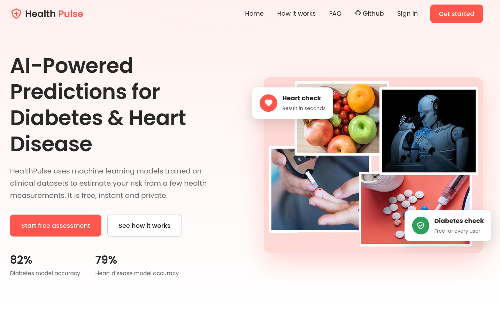

# HealthPulse - Predictive Health Monitoring 🌐💓🤖

Welcome to HealthPulse, a revolutionary health monitoring system that combines Flask, MongoDB, and machine learning to empower users with predictive health insights. This comprehensive platform offers real-time tracking of various health metrics while leveraging advanced analytics to predict the risk of diabetes and heart diseases.



## Key Features 🚀

- **Predictive Analytics:** Harness the power of machine learning to receive personalized predictions for diabetes and heart diseases based on your health data.

- **Holistic Health Tracking:** Monitor physical activity, sleep patterns, and nutritional intake in real-time, providing a complete picture of your well-being.

- **Personalized Recommendations:** Receive tailored health recommendations derived from predictive models, enabling proactive health management.

- **Secure User Authentication:** Ensure the security and privacy of sensitive health data with Flask's robust user authentication.

- **Scalable MongoDB Storage:** Utilize MongoDB's scalability to efficiently store and retrieve extensive health data, supporting the platform's growth.

## Getting Started 🚀

1. **Clone the Repository:** `git clone https://github.com/therituraj/HealthPulse.git`
2. **Move inside api:** `cd api`
3. **Install Dependencies:** `pip install -r requirements.txt`
4. **Make an .env file and put inside this:** 
```bash
MONGO_URI="your mongodb uri"
SECRET_KEY="your secret key"
```
5. **Run the Application:** `python index.py`

## How to Contribute 🤝

HealthPulse welcomes contributions from developers, data scientists, and healthcare enthusiasts. Whether you're skilled in Flask, machine learning, or frontend design, your expertise is valued. Fork the repository, make enhancements, and submit pull requests to contribute to the future of health monitoring.

## License 📄

This project is licensed under the [MIT License](LICENSE).

## Authors 👥


If you have any questions, suggestions, or feedback, please feel free to reach out to us at:

- Website: [https://therituraj.in/](https://therituraj.in/)

You can also connect with us on social media:

- LinkedIn: [enrituraj](https://www.linkedin.com/in/enrituraj/)

Embark on a transformative health journey with HealthPulse, where technology meets well-being. Together, let's revolutionize health monitoring and prediction for a healthier future! 💪🏽💚📈
